# Отчет по Лабе 5

## 1. Краткое описание выбранного трека

Для выполнения работы был выбран трек **C (TypeBot)**. Это low-code/no-code платформа для визуального проектирования чат-ботов. Главным преимуществом TypeBot в рамках данной лабораторной работы является возможность полноценного экспорта созданного flow в формат JSON, что позволяет сохранить результаты работы в репозиторий.
В качестве основы был выбран шаблон **Lead Generation** (Сбор лидов), который впоследствии был полностью русифицирован и дополнен новой логикой.

## 2. Ссылка на бота

https://typebot.co/lead-generation-qsrhaps

## 3. Использованные AI-промпты

**Промпт 1**
*Как это реализовать: при вводе пробела вместо своего имени, пользователя просит повторно ввести свое имя*
**Промпт 2** 
*Сделай красивый отчет для этой лабы.*

## 4. Освоенные блоки и элементы

В процессе работы были изучены и применены следующие элементы платформы:

- *Text Message* - Приветствие, вывод вопросов и финальных сообщений.
- *Text Input* - Сбор данных от пользователя (Имя, Email, Группа).
- *Buttons (Choice)* - Интерактивный выбор интересующих услуг.
- *Set Variable* - Принудительная запись данных в переменную `Group`.
- *Condition* - Ветвление логики (проверка на пустоту `Is empty` и проверка на совпадение `Contains`).
- *HTTP Request* - Интеграция с внешним API (тестовый запрос на `httpbin.org`).
- *Theme* - Изменение брендинга, цветовой схемы и аватара бота.

## 5. Скриншоты

### Создание и регистрация
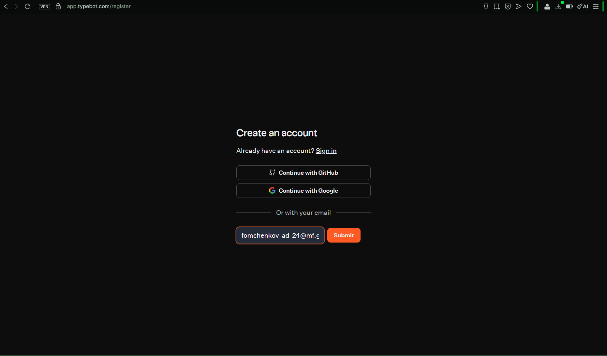
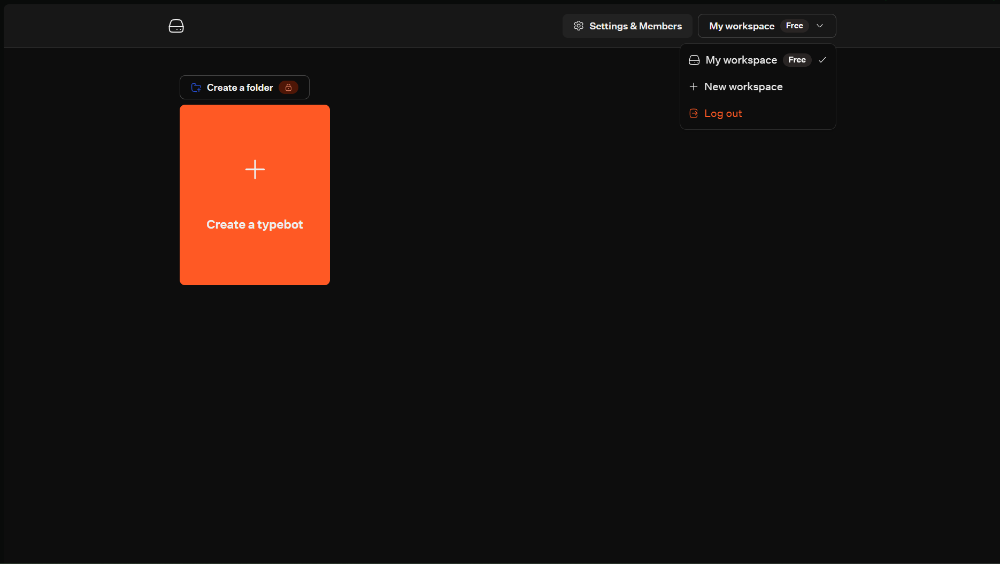

### Русификация

**До перевода:**
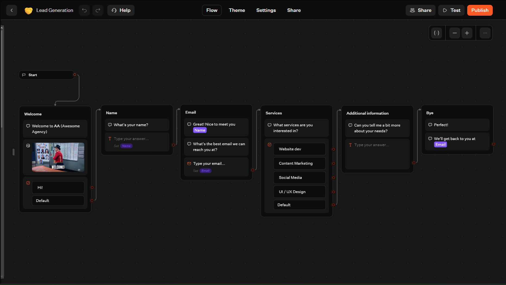
**После перевода:**
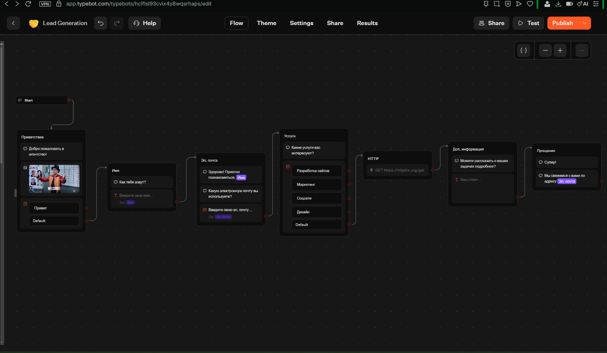

### Смена цвета темы

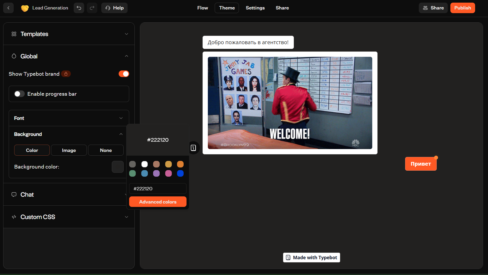
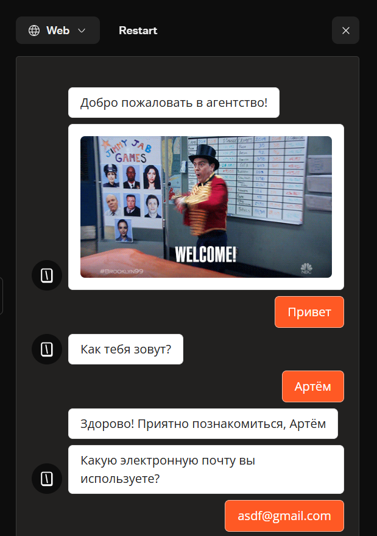
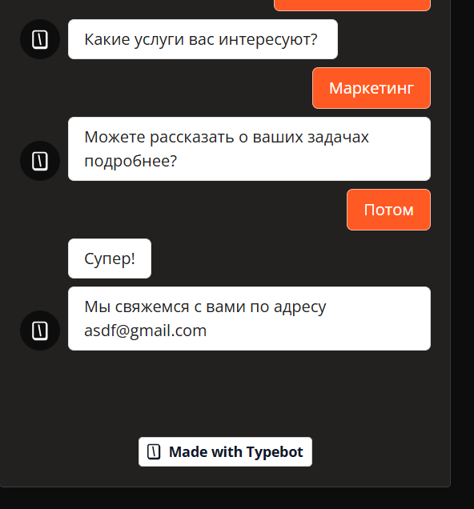

### Добавил блоки условия и переменной

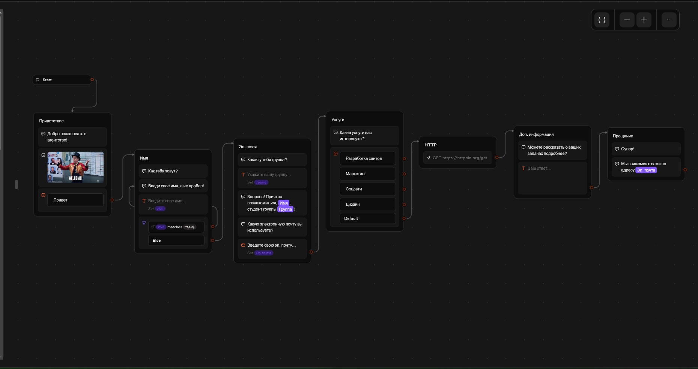

### Тест итогового варианта

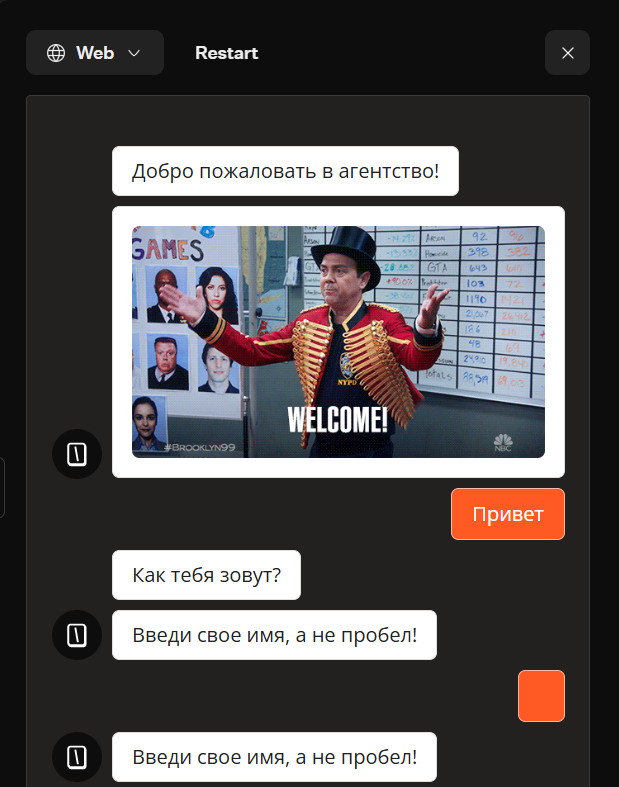
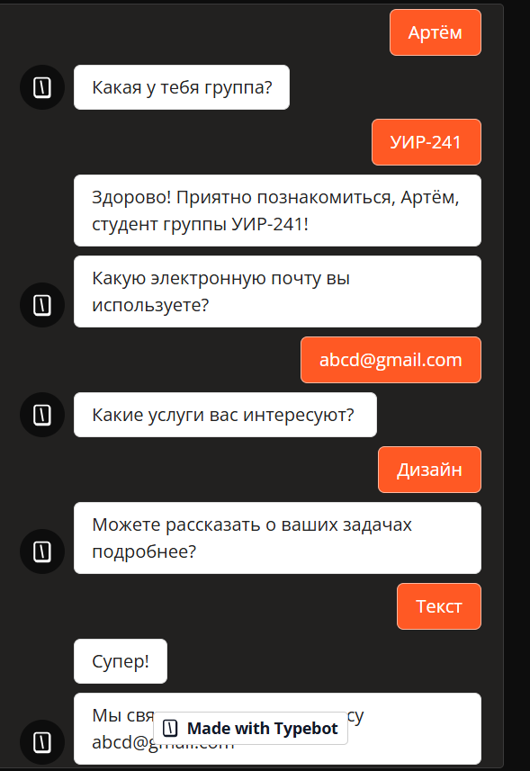

### Тест http запроса

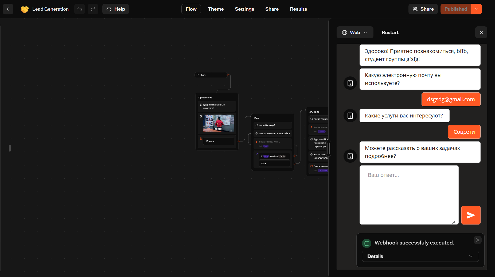

### Проверка ссылки

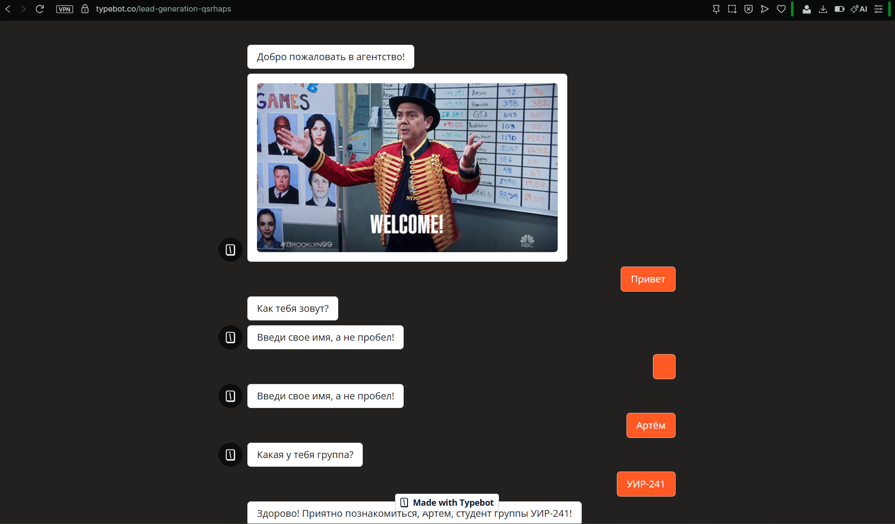
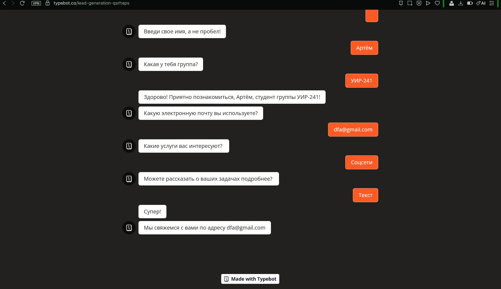

## 6. Выводы

В ходе выполнения лабораторной работы я освоил платформу TypeBot для создания чат-ботов. Были изучены принципы построения визуальных сценариев (flow), работа с переменными и условными переходами.