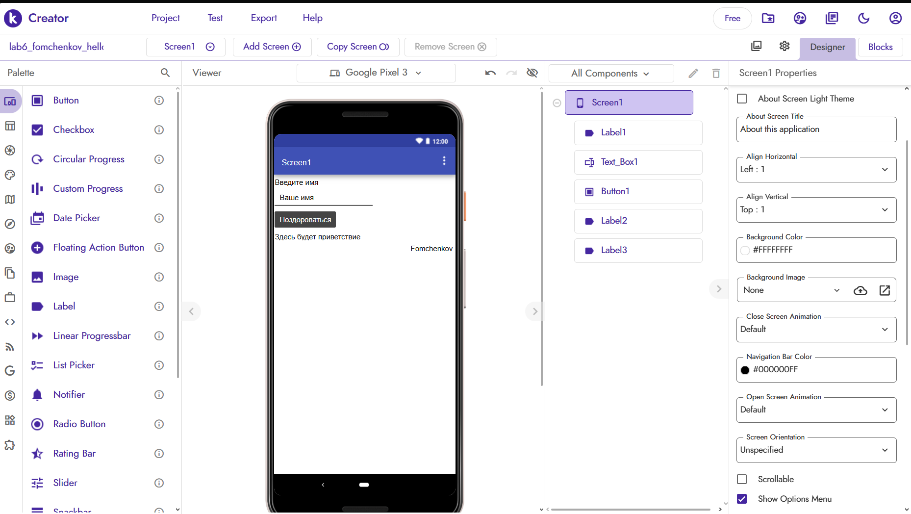
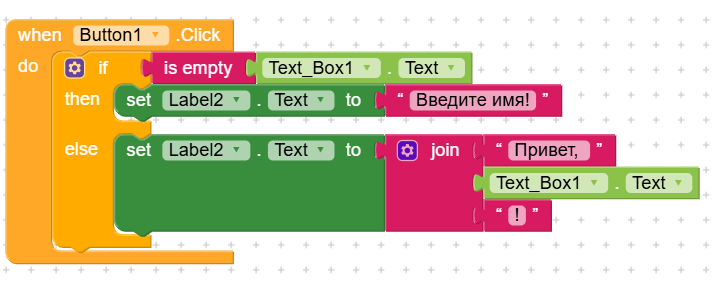
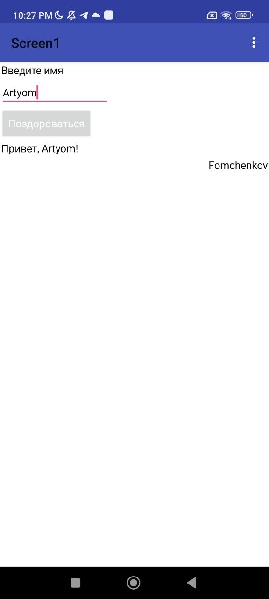

# Отчёт по лабораторной работе №6. Kodular

---

## 1. Описание приложения

Реализовано базовое приложение «Приветствие» на платформе Kodular.

**Функциональность:**
- На экране `Screen1` расположены:
  - `Label1` — заголовок «Введите имя»;
  - `Text_Box1` — поле ввода с подсказкой «Ваше имя»;
  - `Button1` — кнопка «Поздороваться»;
  - `Label2` — поле вывода результата (изначально «Здесь будет приветствие»);
  - `Label3` — фамилия студента на английском (`Fomchenkov`), видимая при запуске.
- Логика (блоки):
  - При нажатии на `Button1` проверяется, пусто ли поле `Text_Box1`.
  - Если пусто → в `Label2` выводится «Введите имя!».
  - Иначе → в `Label2` выводится «Привет, <имя>!» с использованием блока `join`.
- Использованы блоки `if/else` и `join`.

---

## 2. Ссылка на проект / экспорт

Функция публикации в Kodular Gallery в используемой версии платформы недоступна, поэтому проект предоставлен в виде экспортированного `.aia`-файла:

- **Экспорт проекта:** [lab6-fomchenkov.aia](../exports/lab6-fomchenkov.aia)

---

## 3. Использованные AI-промпты

В ходе выполнения работы использовались следующие промпты к ИИ-ассистенту:

1. **Помоги сделать логику для этого приложения**  
2. **Помоги исправить логику в блоках, потому что при нажатии "Поздороваться" у меня ничего не происходит на телефоне**

---

## 4. Освоенные компоненты и блоки

### Компоненты (Designer)
- `Label` — для вывода текста (заголовок, результат, фамилия).
- `TextBox` — поле ввода имени (свойство `Hint`).
- `Button` — кнопка «Поздороваться».

### Блоки (Blocks Editor)
- `when Button1.Click do` — обработчик события нажатия.
- `if / then / else` — условный оператор.
- `is empty` — проверка строки на пустоту.
- `set Label.Text to` — изменение текста метки.
- `join` — соединение строк.
- Обращение к свойству `.Text` компонента `Text_Box1`.

---

## 5. Скриншоты

### Базовое задание

**Экран дизайнера (Screen1) с фамилией:**

**Блоки логики (Button1.Click):**

**Вид в самом приложении**

---

## 6. Ограничения бесплатного тарифа Kodular

В ходе работы столкнулся со следующими ограничениями бесплатного тарифа:

1. **Лимит проектов:** максимум 10 проектов на аккаунт. При превышении требуется удалять старые проекты.
2. **Лимит ассетов:** до 10 МБ на проект (изображения, звуки, шрифты). Для простого приложения этого достаточно.
3. **Лимит расширений (Extensions):** до 5 расширений на проект.
4. **Отсутствие функции Publish to Gallery** в некоторых регионах/версиях — невозможно получить публичную ссылку на проект.
5. **Реклама:** при сборке APK в бесплатном тарифе автоматически добавляется реклама Kodular.
6. **Ограничения сборки:** длительная очередь на сборку APK в периоды высокой нагрузки.

---

## 7. Выводы

В ходе лабораторной работы я освоил базовые принципы визуального программирования на платформе Kodular:

- Научился размещать компоненты на экране и настраивать их свойства в Designer.
- Разобрался с блочным программированием: события (`when`), условия (`if/else`), работа со строками (`join`).
- Понял важность правильной вложенности блоков — именно ошибка с невложенным `if` привела к тому, что кнопка не реагировала на нажатия.
- Освоил экспорт проекта в формате `.aia` и способы проверки его целостности.
- Познакомился с ограничениями бесплатного тарифа Kodular.

---