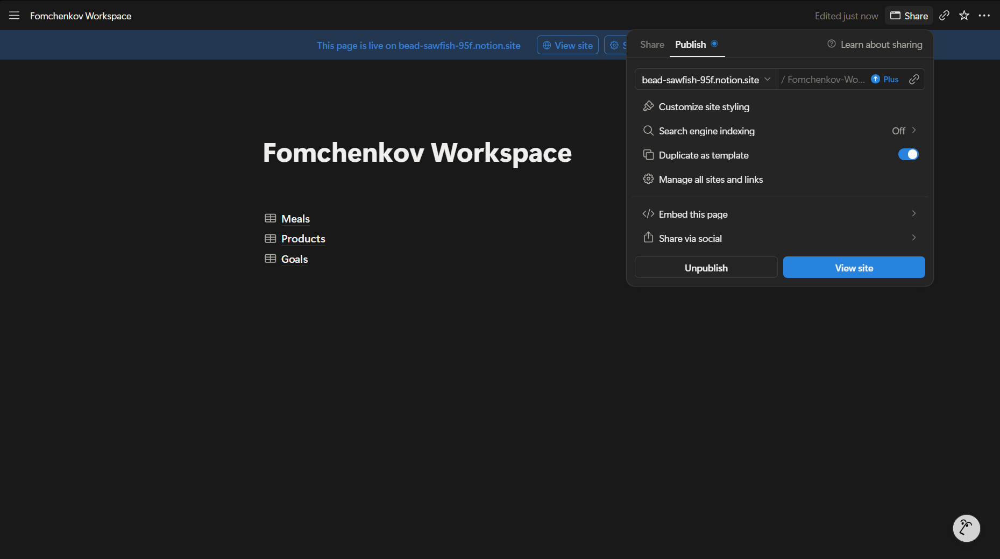
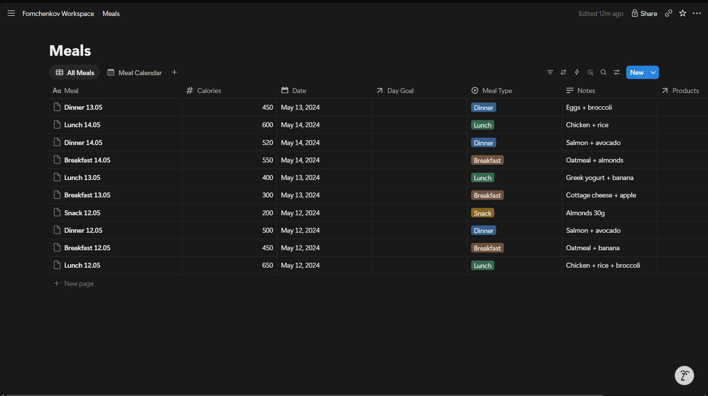
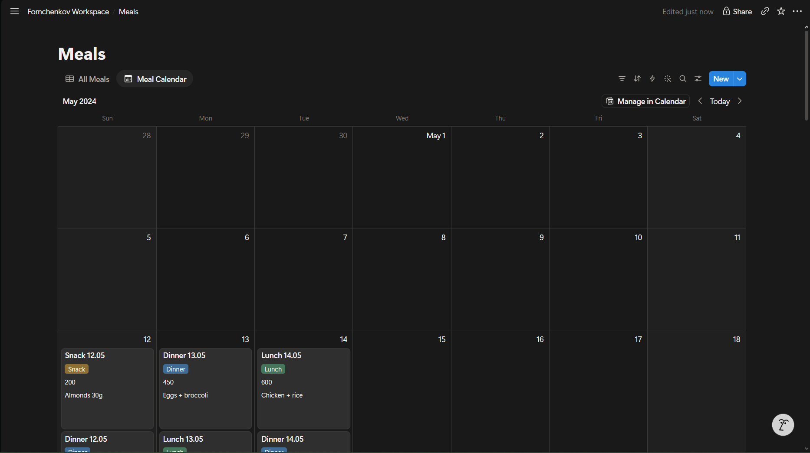
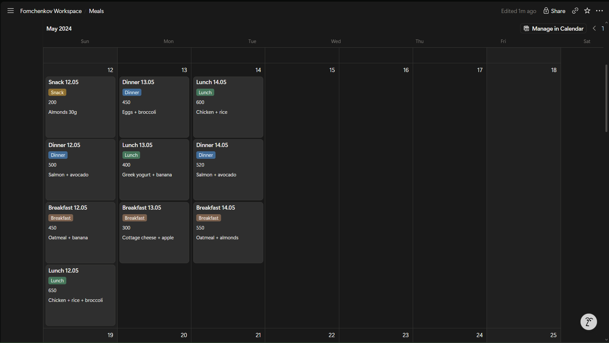
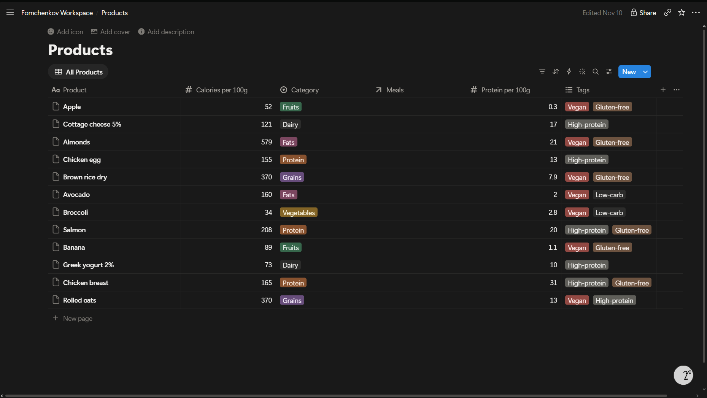
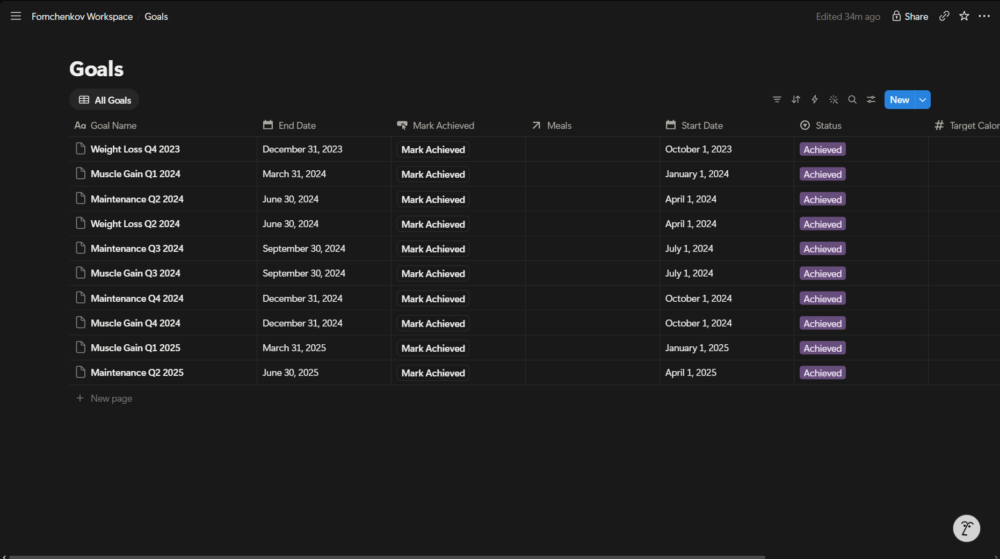
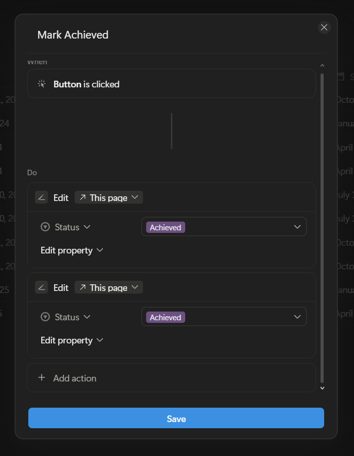

# Отчет по лабораторной работе №7: Notion

## 1. Описание предметной области и модели данных

**Предметная область:** Персональный трекер фитнес-питания и планирования целей (Fitness & Nutrition Tracker).  
**Цель системы:** Учет потребляемых продуктов, контроль калорийности приемов пищи и отслеживание прогресса в достижении фитнес-целей (набор массы, похудение, поддержка) на протяжении времени.

### Модель данных (Сущности)

В системе реализованы 3 связанные сущности (базы данных):

1.  **Products (Продукты)** — справочник продуктов питания с их нутриентами.
    *   *Свойства:* Product (Title), Category (Select), Tags (Multi-select), Calories per 100g (Number), Protein per 100g (Number).
2.  **Goals (Цели)** — планы тренировок и питания на определенные периоды (кварталы).
    *   *Свойства:* Goal Name (Title), Start Date (Date), End Date (Date), Target Calories (Number), Target Protein (Number), Status (Select), Meals (Relation).
3.  **Meals (Приемы пищи)** – журнал съеденного.
    *   *Свойства:* Meal (Title), Meal Type (Select), Date (Date), Calories (Number), Notes (Text), Day Goal (Relation).

### Связи
*   **Meals ↔ Goals (Relation):** Связь "Day Goal" позволяет привязать каждый прием пищи к конкретной цели (например, к "Muscle Gain Q1 2024"). Это позволяет анализировать, насколько питание соответствовало плану в конкретный период.

---

## 2. Генерация модели через ИИ

### Промпт 1 (Генерация структуры)
Для генерации структуры базы данных использовался следующий промпт:

> Create a new page called "Fomchenkov Workspace" (or use the current one). Create three databases on this page with English titles and English data.
>
> 1. Database "Products":
> Properties:
> - Product (Title)
> - Category (Select: Grains, Protein, Dairy, Fruits, Vegetables, Fats)
> - Tags (Multi-select: Vegan, High-protein, Gluten-free, Low-carb)
> - Calories per 100g (Number)
> - Protein per 100g (Number)
>
> Data to add:
> - Rolled oats, Grains, Vegan, High-protein, 370, 13
> - Chicken breast, Protein, High-protein, Gluten-free, 165, 31
> - Greek yogurt 2%, Dairy, High-protein, 73, 10
> - Banana, Fruits, Vegan, Gluten-free, 89, 1.1
> - Broccoli, Vegetables, Vegan, Low-carb, 34, 2.8
> - Salmon, Protein, High-protein, Gluten-free, 208, 20
> - Brown rice dry, Grains, Vegan, Gluten-free, 370, 7.9
> - Chicken egg, Protein, High-protein, 155, 13
> - Avocado, Fats, Vegan, Low-carb, 160, 2
> - Almonds, Fats, Vegan, Gluten-free, 579, 21
> - Cottage cheese 5%, Dairy, High-protein, 121, 17
> - Apple, Fruits, Vegan, Gluten-free, 52, 0.3
>
> 2. Database "Goals":
> Properties:
> - Goal Name (Title)
> - Start Date (Date)
> - End Date (Date)
> - Target Calories (Number)
> - Target Protein (Number)
> - Status (Select: Active, Achieved, Paused)
>
> Data to add:
> - Weight Loss Q2 2024, 2024-04-01, 2024-06-30, 1800, 120, Active
> - Maintenance Q3 2024, 2024-07-01, 2024-09-30, 2200, 130, Active
> - Muscle Gain Q1 2024, 2024-01-01, 2024-03-31, 2800, 160, Achieved
> - Weight Loss Q4 2023, 2023-10-01, 2023-12-31, 1700, 110, Achieved
> - Maintenance Q2 2024, 2024-04-01, 2024-06-30, 2100, 125, Paused
>
> 3. Database "Meals":
> Properties:
> - Meal (Title)
> - Meal Type (Select: Breakfast, Lunch, Dinner, Snack)
> - Date (Date)
> - Calories (Number)
> - Notes (Text)
>
> Data to add:
> - Breakfast 12.05, Breakfast, 2024-05-12, 450, Oatmeal + banana
> - Lunch 12.05, Lunch, 2024-05-12, 650, Chicken + rice + broccoli
> - Dinner 12.05, Dinner, 2024-05-12, 500, Salmon + avocado
> - Snack 12.05, Snack, 2024-05-12, 200, Almonds 30g
> - Breakfast 13.05, Breakfast, 2024-05-13, 300, Cottage cheese + apple
> - Lunch 13.05, Lunch, 2024-05-13, 400, Greek yogurt + banana
> - Dinner 13.05, Dinner, 2024-05-13, 450, Eggs + broccoli
> - Breakfast 14.05, Breakfast, 2024-05-14, 550, Oatmeal + almonds
> - Lunch 14.05, Lunch, 2024-05-14, 600, Chicken + rice
> - Dinner 14.05, Dinner, 2024-05-14, 520, Salmon + avocado
>
> After creating the databases, add a Relation property in the "Meals" database named "Day Goal", linking to the "Goals" database. Enable "Show on Goals".

### Промпт 2 (Реализация требований лабы)
После создания баз данных был использован второй промпт для проверки и доработки структуры согласно требованиям лабораторной работы:

> 1. Создайте главную страницу с заголовком, содержащим вашу фамилию на английском (например, Ivanov's Workspace).
> 2. Создайте 3–4 базы данных по сгенерированной модели.
> 3. Настройте минимум 2 связи Relation между базами.
> 4. Наполните базы реалистичными данными (минимум 10 записей в каждой)
> 5. Настройте минимум два представления для одной из баз: например, таблица и канбан, или таблица и календарь.
> 6. Добавьте минимум одну кнопку (Button) с простым действием.

### Что было исправлено и уточнено после генерации

После первоначальной генерации ИИ потребовалась ручная доработка для соответствия требованиям лабы и логике предметной области:

1.  **Количество записей:** ИИ сгенерировал только 5 целей в базе `Goals`. Требование лабы — минимум 10 записей. Я вручную добавил еще 5 целей.
2.  **Хронология и дубликаты:** В исходном ответе присутствовали дубликаты названий (два раза `Muscle Gain Q1 2024`). Я переименовал их, соблюдая строгий порядок кварталов (Q1 → Q2 → Q3 → Q4) и годов, чтобы база отражала реальный тренировочный цикл.
3.  **Логика данных:** Скорректировал значения `Target Calories` и `Target Protein` для новых целей, чтобы они соответствовали типу нагрузки (для Muscle Gain калории выше, чем для Maintenance).
4.  **Представления:** Самостоятельно добавил представления **Calendar** и **Board** для базы `Meals`, так как ИИ создал только Table view.
5.  **Кнопка:** Создал кнопку для быстрого добавления записей, настроив её действие через интерфейс Notion.

---

## 3. Ссылка на опубликованную страницу

[https://bead-sawfish-95f.notion.site/Fomchenkov-Workspace-414436e4423b80eab368c1f5bc4a2739?source=copy_link](https://bead-sawfish-95f.notion.site/Fomchenkov-Workspace-414436e4423b80eab368c1f5bc4a2739?source=copy_link)

---

## 4. Освоенные компоненты Notion

*   Создание и настройка баз данных (Table view).
*   Настройка свойств: Title, Select, Multi-select, Date, Number, Relation, Formula.
*   Создание связей (Relations) между базами данных.
*   Работа с представлениями (Views): Table, Calendar, Board.
*   Использование кнопок (Buttons) для автоматизации создания записей.
*   Публикация страниц в веб (Share to web).

---

## 5. Скриншоты

### Главная страница и публикация

*Главная страница workspace опубликована.*

### Промпты и генерация

*Скриншоты процесса генерации структуры через ИИ.*

### Внесение изменений и наполнение данными

*Процесс добавления представлений (Calendar), заполнения данных и настройки связей.*

### Настройка кнопки

*Настройка действия кнопки для автоматического создания записей.*

---

## 6. Выводы

В ходе выполнения лабораторной работы я освоил Notion как платформу для управления персональными данными. Была спроектирована и реализована модель трекера питания, которая демонстрирует использование реляционных связей, вычисляемых полей и автоматизации.